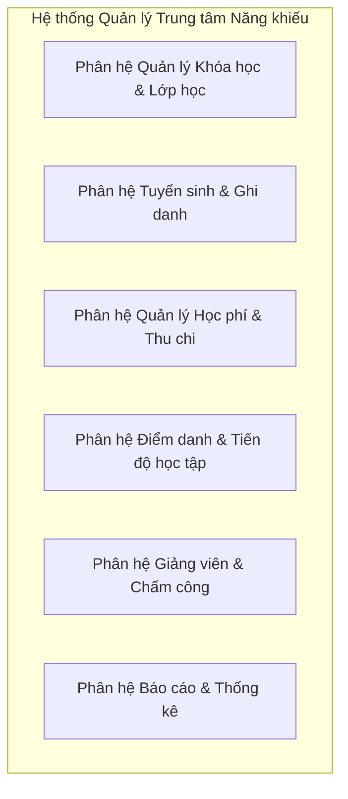
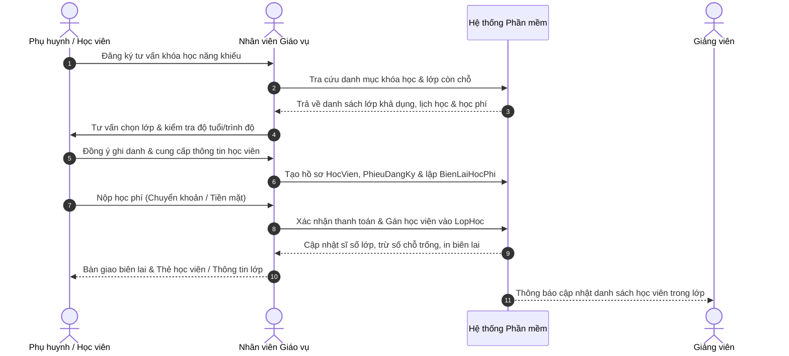
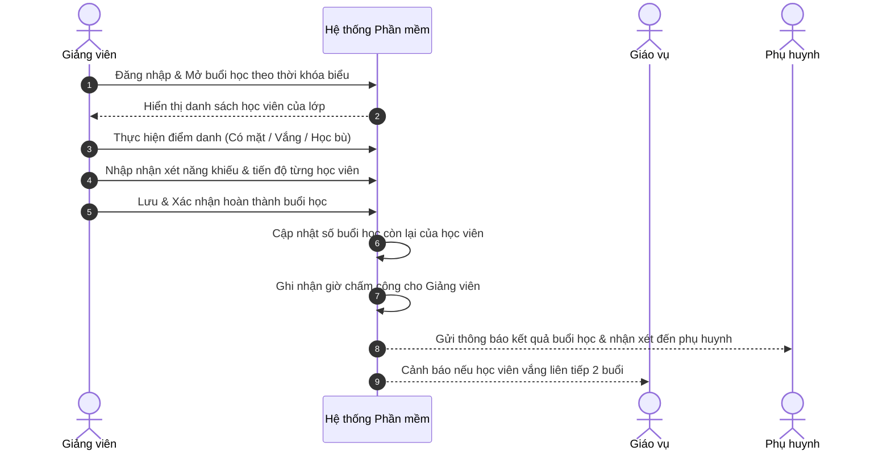

# Đề tài SE100: Phần mềm quản lý trung tâm dạy năng khiếu

> Phạm vi triển khai ngày 04/11 tập trung vào một trung tâm âm nhạc, lớp tại trung tâm và lớp online, giáo trình từng buổi và tài khoản học viên. Đọc [nền dùng chung](./planning/2026-11-04/FOUNDATION_BLUEPRINT.md), [phân công](./planning/2026-11-04/README.md) và [hướng dẫn chạy](../README.md). Nội dung theo ngày 14/10 dưới đây ghi lại giai đoạn phân tích trước.

> **Đồng bộ ngày 14/10/2026 (Asia/Saigon).** Phạm vi dưới đây là phương án phân tích trong báo cáo cục bộ, cần được nhóm và đại diện trung tâm rà soát. Hồ sơ hiện có chưa chứng minh đã khảo sát thực tế, trình bày/nộp báo cáo hoặc được giảng viên duyệt.

## Phạm vi đề xuất ngày 14/10/2026

[Bản DOCX lần 1 hiện có](./report/SE100_BaoCaoTienDo_Dot1_Scope_SRS.docx) và [nguồn báo cáo ngày 14/10](./report/_work_dot1_20261014/report_source.md) là căn cứ của phần này. Báo cáo xác định 18 FR, 8 NFR, 12 BR, 5 Use Case và TC01–TC12 dự kiến; các mã TC chưa thể hiện kiểm thử đã chạy. Nhân sự sáu người và vai trò trưởng nhóm Quốc Hướng được ghi theo báo cáo tại [AGENTS.md](../AGENTS.md).

Ứng dụng web nội bộ phục vụ một chi nhánh. Ba tác nhân trực tiếp là **Quản lý, Giáo vụ và Giảng viên**; Học viên/Phụ huynh cung cấp thông tin và làm việc qua Giáo vụ. Khóa là mẫu chương trình theo môn/cấp độ; lớp là đợt tổ chức có số buổi cố định; lớp một kèm một dùng cùng mô hình với sĩ số tối đa bằng 1. Ghi danh chỉ trước buổi đầu, thu đủ học phí trọn khóa một lần.

| Trong MVP đề xuất | Ngoài MVP đề xuất |
| --- | --- |
| Hồ sơ học viên và người liên hệ; môn, cấp độ, khóa, phòng và giảng viên. | Nhiều chi nhánh; cổng phụ huynh/học viên, ứng dụng di động và học trực tuyến. |
| Mở lớp, xếp từng buổi; kiểm tra trùng phòng, giảng viên, học viên và lịch bù. | Tối ưu thời khóa biểu tự động; quản lý kho, bảo trì thiết bị. |
| Ghi danh Chờ thanh toán không giữ chỗ; thu đủ một lần bằng tiền mặt hoặc chuyển khoản; phiếu thu nội bộ và sổ tiền chờ xử lý. | Ghi danh giữa khóa; thu theo tháng/nhiều đợt, thẻ buổi linh hoạt, khuyến mãi, cổng thanh toán và đối soát ngân hàng tự động. |
| Điểm danh, nhận xét, đề nghị nghỉ, quyền học bù và lượt học bù; báo cáo sĩ số, chuyên cần, học phí và khoản tiền đã nhận. | Tính lương/chấm công để trả lương, kế toán/hóa đơn điện tử, cấp chứng chỉ, bảo lưu dài hạn và chuyển lớp/hoàn phí tự động. |
| Phân quyền máy chủ, lịch sử thay đổi, tra cứu/lọc/phân trang và xuất CSV theo quyền. | Tự động gửi SMS/Zalo, AI/chatbot và phân tích nâng cao. |

### Luồng và quy tắc cần thống nhất

Giáo vụ mở lớp đủ lịch → lập ghi danh Chờ thanh toán → kiểm tra lại chỗ/lịch và nhận đủ tiền → lập phiếu thu, kích hoạt ghi danh trong cùng giao dịch → chốt điểm danh → bố trí học bù khi đủ điều kiện → đối chiếu báo cáo. Nếu đã nhận tiền nhưng giao dịch chưa kích hoạt được, ghi sổ khoản chờ để Quản lý xác nhận ghi nhận lại hoặc xác nhận đã trả tiền thủ công có bằng chứng; khoản chờ và phiếu hiệu lực được đối chiếu để tránh bỏ sót/cộng trùng.

Sĩ số của một buổi tính cả học viên chính thức dự kiến vắng và các lượt bù đã bố trí. Lịch chỉ được đổi/hủy trước giờ bắt đầu; buổi hủy của lớp tiếp tục học có buổi thay thế liên kết. Điểm danh lớp gốc có Có mặt, Vắng có phép, Vắng không phép; kết quả học bù lưu riêng, không trở thành trạng thái điểm danh thứ tư. Vắng có phép cần Giáo vụ duyệt trước chốt.

**Hạn bù đề xuất** là 30 ngày sau ngày kết thúc dự kiến của lớp gốc tại lúc cấp quyền; kéo dài lớp chỉ gia hạn quyền chưa sử dụng khi hạn mới muộn hơn. BR11 trong báo cáo mô tả cách xử lý quyền hết hạn, lượt đã diễn ra chờ chốt và chốt muộn. Đây là chính sách cần khảo sát xác nhận. Các số 12 giờ và 6 tháng của bản 22/09 ở phần lịch sử là giả định ban đầu, chưa phải chính sách đã chốt.

[Sơ đồ Mermaid lần 1](./diagrams/SE100_DOT1_DIAGRAMS.md) biểu diễn tác nhân, luồng, mô hình miền tài chính và lớp/học bù. Các mô hình là phân tích sơ bộ; Activity/Sequence chi tiết, lớp có thuộc tính/phương thức, ERD, Screen Flow và prototype còn là đầu ra tiếp theo.

### Trạng thái và việc tiếp theo

Đã có bản báo cáo cục bộ ngày 14/10, bốn sơ đồ và QR dẫn tới biểu mẫu góp ý trong lớp. QR phục vụ phản biện báo cáo; khảo sát yêu cầu trung tâm là hoạt động riêng. Chưa có bằng chứng đã thu góp ý hoặc được công nhận điểm cộng. Lịch báo cáo chính thức và công nghệ triển khai cụ thể chưa có trong nguồn hiện hành.

Tiếp theo: khảo sát các chính sách thu trọn khóa/không giữ chỗ, nghỉ/học bù và xử lý tiền; rà soát SRS; hoàn thiện UML và prototype cho lần 2 theo phân công đề xuất trong báo cáo. Ghi nguồn khi xác nhận lịch, trạng thái nộp/duyệt hoặc thay đổi phạm vi.

---

## Định hướng ban đầu ngày 22/09/2026 — lịch sử

> Phần dưới giữ nội dung của tài liệu “Khảo sát & Định hướng Đề tài: Phần mềm Quản lý Trung tâm Dạy Năng khiếu” ban đầu. Đây là bối cảnh và phương án rộng để tham khảo; chưa có biên bản khảo sát trung tâm trong hồ sơ. Những chức năng bị loại khỏi MVP được giữ để tra cứu hướng mở rộng, không trở thành cam kết triển khai chỉ vì còn xuất hiện ở đây.

> **Môn học**: Phương pháp phát triển phần mềm hướng đối tượng (SE100)  
> **Đề tài**: Phần mềm quản lý trung tâm dạy năng khiếu (*Art & Talent Academy Management System*)  
> **Trưởng nhóm**: Trần Hữu Quốc Hướng (MSSV: `24520644`)  
> **Ngày khởi tạo**: 22/09/2026  

---

### 1. Tổng quan & Lý do chọn đề tài

#### 1.1. Bối cảnh & Hiện trạng thực tế
- Nhu cầu phát triển năng khiếu nghệ thuật, thể thao và tư duy (Âm nhạc, Hội họa, Cờ vua, Múa, Kỹ năng sống/MC...) cho trẻ em và thanh thiếu niên ngày càng tăng cao.
- Các trung tâm năng khiếu hiện nay thường có quy mô từ nhỏ đến vừa, đa phần quản lý qua sổ sách rời rạc hoặc bảng tính Excel:
  - **Khó khăn trong quản lý lớp và lịch học**: Lớp học năng khiếu có tính linh hoạt cao (lớp cá nhân 1-1, lớp nhóm nhỏ 3-5 học viên, lớp cộng đồng), thường xuyên xảy ra tình trạng trùng lịch giáo viên hoặc trùng phòng học chuyên dụng (phòng piano, phòng vẽ, sân cờ).
  - **Theo dõi học phí & chính sách bảo lưu**: Học viên năng khiếu thường đăng ký theo khóa (khóa 12-24 buổi) hoặc theo tháng, hay có nhu cầu nghỉ học có phép, học bù, bảo lưu học phí. Quản lý thủ công dễ gây thất thoát, nhầm lẫn công nợ.
  - **Quản lý thù lao giảng viên**: Giảng viên thường cộng tác theo buổi/giờ dạy thực tế hoặc tỷ lệ ăn chia theo học viên. Việc tổng hợp giờ dạy cuối tháng tốn nhiều thời gian và dễ sai sót.
  - **Kết nối với phụ huynh**: Phụ huynh cần nắm được tình hình chuyên cần và sự tiến bộ từng buổi học của con em mình, nhưng việc trao đổi thủ công qua tin nhắn cá nhân thiếu tính hệ thống và minh bạch.

#### 1.2. Mục tiêu đề tài
Xây dựng một hệ thống phần mềm hướng đối tượng hoàn chỉnh giúp:
1. Chuẩn hóa và tự động hóa quy trình quản lý tuyển sinh, ghi danh, xếp lớp, xếp lịch và thu học phí.
2. Quản lý tài nguyên trung tâm (phòng học, trang thiết bị/nhạc cụ) và lịch giảng dạy tối ưu, chống xung đột thời khóa biểu.
3. Quản lý điểm danh, chấm công giảng viên và đánh giá tiến độ rèn luyện năng khiếu của học viên.
4. Cung cấp báo cáo tài chính - doanh thu, sĩ số và hiệu suất vận hành cho Ban giám đốc trung tâm.

---

### 2. Phạm vi hệ thống & Các phân hệ nghiệp vụ cốt lõi

#### 2.1. Phân hệ Quản lý Khóa học & Lớp học
- **Quản lý Môn năng khiếu**: Âm nhạc (Piano, Guitar, Violin, Thanh nhạc), Hội họa (Màu nước, Sơn dầu, Digital Art), Tư duy/Thể thao (Cờ vua, Võ thuật, Yoga kids), Kỹ năng (MC, Diễn xuất).
- **Quản lý Khóa học & Cấp độ (Level)**: Cơ bản, Trung cấp, Nâng cao, Luyện thi chứng chỉ quốc tế (ABRSM, RockSchool, Trinity...).
- **Quản lý Phòng học & Thiết bị**: Sức chứa, danh mục nhạc cụ/thiết bị cố định trong phòng.
- **Mở lớp & Xếp thời khóa biểu**:
  - Loại hình lớp: Lớp 1-kèm-1, Lớp nhóm cố định, Lớp theo buổi linh hoạt.
  - Xếp lịch: Ca học, thứ trong tuần, phòng học, giảng viên phụ trách.
  - Ràng buộc: Tự động kiểm tra không trùng phòng học và không trùng lịch giảng viên.

#### 2.2. Phân hệ Tuyển sinh, Ghi danh & Học viên
- **Hồ sơ Học viên & Phụ huynh**: Họ tên, ngày sinh, trường đang học, thông tin phụ huynh liên hệ (SĐT, Email, Zalo), sở thích/năng khiếu ban đầu.
- **Tiếp nhận đăng ký & Ghi danh**:
  - Đăng ký mới vào lớp học phù hợp với độ tuổi và trình độ.
  - Xử lý chuyển lớp, chuyển ca học.
  - Xử lý xin nghỉ phép, học bù, bảo lưu số buổi còn lại.

#### 2.3. Phân hệ Quản lý Học phí & Chứng từ
- **Biểu phí khóa học**: Đơn giá khóa trọn gói hoặc tính theo số buổi học.
- **Thu học phí & Lập biên lai**:
  - Áp dụng các chính sách ưu đãi (Học bổng, giảm học phí khi đăng ký nhiều môn/khóa, giảm giá anh chị em ruột).
  - Xuất biên lai/phiếu thu, ghi nhận hình thức thanh toán (Tiền mặt, Chuyển khoản, Thẻ).
  - Cảnh báo học phí sắp hết hạn hoặc quá hạn đóng tiền đợt kế tiếp.

#### 2.4. Phân hệ Điểm danh & Đánh giá năng khiếu
- **Điểm danh buổi học**:
  - Ghi nhận trạng thái: Có mặt, Vắng có phép, Vắng không phép, Học bù.
  - Tự động trừ số buổi trong thẻ học của học viên.
- **Sổ nhật ký rèn luyện & Đánh giá**:
  - Giảng viên ghi nhận xét bài học, mức độ hoàn thành bài tập, năng khiếu nổi bật.
  - Đánh giá định kỳ cuối khóa hoặc cấp chứng chỉ hoàn thành cấp độ.

#### 2.5. Phân hệ Giảng viên & Chấm công
- **Hồ sơ Giảng viên**: Thông tin cá nhân, chuyên môn, chứng chỉ, lịch rảnh đăng ký dạy.
- **Chấm công dạy học**: Tự động tổng hợp số giờ/buổi dạy thực tế dựa trên điểm danh lớp học.
- **Tính lương/Thù lao**: Tính theo định mức thù lao/giờ hoặc theo % số học viên của lớp.

#### 2.6. Phân hệ Báo cáo & Thống kê
- Thống kê doanh thu theo thời gian (ngày, tháng, quý, năm) và theo từng môn học.
- Thống kê sĩ số học viên đang học, học viên mới, học viên bảo lưu/nghỉ học.
- Báo cáo công suất sử dụng phòng học và năng suất giảng dạy của giáo viên.

---

### 3. Các tác nhân (Actors) & Thực thể dữ liệu (Entities)

#### 3.1. Danh sách Tác nhân (Actors)
1. **Ban Giám đốc / Quản trị viên (Admin/Manager)**:
   - Toàn quyền quản trị hệ thống, thiết lập danh mục môn học, quy định biểu phí, phê duyệt bảo lưu/hoàn phí lớn, xem báo cáo tài chính tổng quan.
2. **Nhân viên Giáo vụ / Lễ tân (Receptionist/Academic Officer)**:
   - Tiếp nhận tư vấn, ghi danh học viên mới, thu học phí, xuất biên lai, xếp lớp, giải quyết nghỉ phép/học bù, in thẻ học viên.
3. **Giảng viên / Giáo viên năng khiếu (Instructor/Teacher)**:
   - Xem lịch dạy cá nhân, điểm danh lớp học, nhập nhận xét rèn luyện và đánh giá năng khiếu học viên.
4. **Học viên / Phụ huynh (Student/Parent)** *(Phạm vi xem thông tin)*:
   - Xem lịch học, theo dõi kết quả điểm danh, nhận xét của giáo viên và thông báo học phí.

#### 3.2. Danh sách Đối tượng Thực thể cốt lõi (Domain Entities)
- `HocVien` (Student), `PhuHuynh` (Parent)
- `GiaoVien` (Instructor), `ChuyenMon` (Specialty)
- `MonHoc` (Subject/Discipline), `KhoaHoc` (Course), `CapDo` (Level)
- `LopHoc` (Class), `PhongHoc` (Room), `ThietBi` (Equipment)
- `CaHoc` (Shift), `LichHoc` (Schedule), `BuoiHoc` (Lesson/Session)
- `PhieuDangKy` (RegistrationForm), `BienLaiHocPhi` (TuitionReceipt), `KhuyenMai` (Promotion)
- `BangDiemDanh` (Attendance), `PhieuDanhGia` (Evaluation)

---

### 4. Luồng quy trình nghiệp vụ chính (Happy Path)

#### 4.1. Quy trình Tuyển sinh & Ghi danh lớp học

#### 4.2. Quy trình Điểm danh & Đánh giá buổi học

---

### 5. Ràng buộc nghiệp vụ & Kịch bản ngoại lệ (Constraints & Edge Cases)

1. **Ràng buộc chống trùng lịch (Schedule Conflict Constraint)**:
   - Một phòng học không thể xếp cho 2 lớp khác nhau vào cùng một khung giờ.
   - Một giảng viên không thể dạy 2 lớp khác nhau trong cùng một thời điểm.
2. **Ràng buộc sĩ số (Capacity Constraint)**:
   - Sĩ số học viên trong lớp không được vượt quá sĩ số tối đa của lớp hoặc sức chứa của phòng học.
   - Lớp 1-1 chỉ được phép gán duy nhất 1 học viên.
3. **Quy định học bù (Makeup Class Policy)**:
   - Học viên xin nghỉ phải báo trước tối thiểu X giờ (ví dụ 12h) mới được tính là nghỉ có phép và bảo lưu buổi học bù. **Đây là giả định minh họa của bản 22/09, chưa có xác nhận khảo sát; phạm vi ngày 14/10 chưa chốt số giờ báo trước.**
   - Buổi học bù phải xếp vào lớp cùng môn, cùng cấp độ và lớp đó còn chỗ trống.
4. **Quy định hoàn phí & bảo lưu (Refund & Retention Policy)**:
   - Thời gian bảo lưu tối đa 6 tháng kể từ ngày duyệt đơn. **Đây là giả định ban đầu chưa được xác nhận; bảo lưu dài hạn nằm ngoài MVP đề xuất ngày 14/10.**
   - Số tiền hoàn phí tính theo tỷ lệ số buổi chưa học trừ đi chi phí quản lý theo quy định.

---

### 6. Kế hoạch chuẩn bị Báo cáo Lần 1

| Hạng mục | Chi tiết thực hiện | Phụ trách |
| :--- | :--- | :---: |
| **Khảo sát & Mô tả nghiệp vụ** | Hoàn thiện chi tiết Chương 1 (Hiện trạng, bài toán, quy định biểu phí, chứng từ) | Nhóm SE100 |
| **Xác định Use Case & Actor** | Lập sơ đồ Use Case tổng quát và danh sách phân rã Use Case chức năng | Nhóm SE100 |
| **Đặc tả Use Case chính** | Đặc tả: Đăng ký khóa học, Xếp thời khóa biểu, Điểm danh & Đánh giá, Thu học phí | Nhóm SE100 |
| **Activity & Sequence Diagrams**| Vẽ sơ đồ luồng dữ liệu nghiệp vụ bằng Mermaid.js | Nhóm SE100 |
| **Slide báo cáo Lần 1** | Chuẩn bị slide trình bày ngắn gọn, súc tích, **chèn mã QR thu thập ý kiến đóng góp** ở trang đầu | Trưởng nhóm Quốc Hướng |
