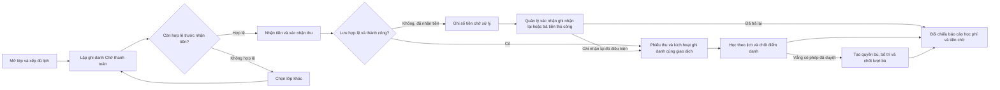
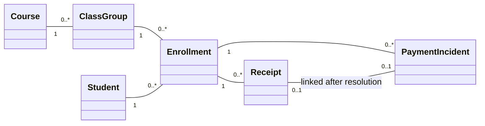
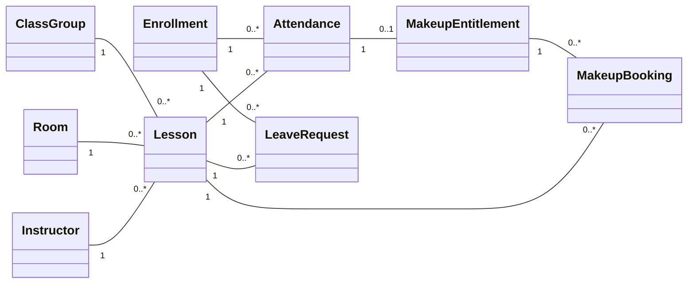

# Sơ đồ báo cáo tiến độ lần 1 SE100

Nguồn Mermaid và ảnh biểu diễn cùng tập tác nhân, nghiệp vụ và quan hệ. Bội số là số bản ghi lịch sử; điều kiện hiệu lực do BR quy định.

## use_cases

```mermaid
flowchart LR
  M["Quản lý"]
  O["Giáo vụ"]
  T["Giảng viên"]
  subgraph SYS["Phần mềm quản lý trung tâm năng khiếu"]
    A(["Quản trị tài khoản và danh mục"])
    B(["Xử lý khoản chờ và sửa sai chứng từ"])
    C(["Hồ sơ, ghi danh và thu học phí"])
    D(["Quản lý lớp và xếp lịch"])
    E(["Duyệt nghỉ và bố trí học bù"])
    F(["Xem lịch, điểm danh và nhận xét"])
    G(["Tra cứu và báo cáo theo phạm vi quyền"])
  end
  M --- A
  M --- B
  M --- F
  O --- C
  O --- D
  O --- E
  O --- G
  T --- F
  T --- G
  M --|> O
```

## workflow



## domain_finance



## domain_learning

